# Secure File Sharing with Encryption

[](https://secure-file-sharing-with-encryption-tau.vercel.app/)
[](https://opensource.org/licenses/MIT)
[](https://fastapi.tiangolo.com/)
[](https://react.dev/)
[](#zero-knowledge-cryptography)

> **IT303 Software Engineering Course Project**  
> **Department of Information Technology, National Institute of Technology Karnataka (NITK), Surathkal**  
> **Course Guide:** Dr. Jaidhar C D  
> **Team Members:**  
> - **Chandan Gowda C** (241IT016)  
> - **Prabhav P** (241IT053)  
> - **Sucheth K Katte** (241IT078)  
>
> 🌐 **Live Web Application:** [https://secure-file-sharing-with-encryption-tau.vercel.app/](https://secure-file-sharing-with-encryption-tau.vercel.app/)  
> 📄 **Official User Manual:** [Secure_File_Sharing_User_Manual.pdf](docs/Secure_File_Sharing_User_Manual.pdf)

---

## Table of Contents

1. [Overview & Zero-Knowledge Architecture](#overview--zero-knowledge-architecture)
2. [Key Features & Capabilities](#key-features--capabilities)
3. [Visual Feature Walkthrough & Screenshots](#visual-feature-walkthrough--screenshots)
   - [Landing Page & Navigation](#1-landing-page--navigation)
   - [Account Registration & Real-Time Password Strength](#2-account-registration--real-time-password-strength)
   - [Two-Factor Authentication (2FA) & 30s Resend Timer](#3-two-factor-authentication-2fa--30s-resend-timer)
   - [Password Recovery Workflow](#4-password-recovery-workflow)
   - [End-to-End Encrypted File Upload](#5-end-to-end-encrypted-file-upload)
   - [Receiver Inbox: Dual Download & Manual Purge Control](#6-receiver-inbox-dual-download--manual-purge-control)
   - [In-App Password Modification](#7-in-app-password-modification)
   - [Account Deletion & Key Purge](#8-account-deletion--key-purge)
   - [System Administrator Audit Panel & Signed PDF Report](#9-system-administrator-audit-panel--signed-pdf-report)
4. [Cryptographic Pipeline](#cryptographic-pipeline)
5. [Tech Stack](#tech-stack)
6. [Repository Structure](#repository-structure)
7. [Local Setup & Installation](#local-setup--installation)
8. [Configuration & Environment Variables](#configuration--environment-variables)
9. [Support & Contact](#support--contact)

---

## Overview & Zero-Knowledge Architecture

**Secure File Sharing with Encryption** is a high-security web platform engineered for confidential digital communication. It guarantees true **Zero-Knowledge End-to-End Encryption (E2EE)**:
- All encryption and decryption operations take place strictly within the client's web browser using standard **WebCrypto API** primitives.
- Plaintext file contents and private cryptographic keys are **never transmitted over the network** and **never stored on the server**.
- The backend serves solely as a blind ciphertext distribution coordinator, relaying encrypted envelopes and maintaining tamper-evident audit trails.

---

## Key Features & Capabilities

- 🔐 **Zero-Knowledge Key Generation:** Client-side generation of NIST P-256 Elliptic Curve Diffie-Hellman (`ECDH`) key pairs. Private keys reside exclusively in browser-isolated `IndexedDB`.
- 📊 **Real-Time Password Entropy Meter:** Active evaluation against length, uppercase, lowercase, numbers, and special characters, strictly blocking weak passwords.
- 🛡️ **Two-Factor Authentication (2FA):** Mandatory 6-digit OTP verification powered by the Brevo transactional email engine with a built-in **30-second resend cooldown timer** and clipboard quick-paste.
- 🚀 **End-to-End Encrypted File Transfer:** Automatic directory lookup of recipient public keys, ephemeral AES-256-GCM symmetric key generation, and authenticated ciphertext delivery.
- 📥 **Flexible Receiver Inbox:**
  - Choose between **Client-Side Decrypt & Download** or **Download Raw Encrypted (.bin)** ciphertext.
  - **Retention & Dual Download:** Files are safely retained so recipients can inspect and download both formats without premature server deletion.
  - **Explicit Purge Control:** Recipients retain full control to remove transfers and permanently wipe server ciphertext storage on demand.
- 🔄 **Self-Service Password Management:** Anti-enumeration password reset emails with 30-minute time-limited JWT tokens, plus in-app authenticated password changes.
- 📜 **Forensic Audit & Administrator Oversight:** Dedicated admin dashboard tracking registered users, **real-time last login timestamps**, formatted file size units (B, KB, MB, GB), and one-click **Signed PDF Audit Report** exports (with IP addresses stripped for privacy).

---

## Visual Feature Walkthrough & Screenshots

### 1. Landing Page & Navigation

The modern, responsive light-themed homepage provides an overview of zero-knowledge guarantees and one-click navigation to login and registration workflows.

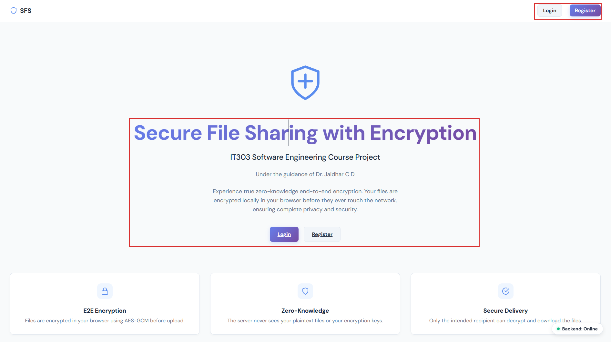

---

### 2. Account Registration & Real-Time Password Strength

Registration initializes user identity and locally derives the ECDH P-256 key pair. The interactive password strength meter evaluates entropy in real time:

| Weak Password Guard | Strong Password Accepted |
| :---: | :---: |
| 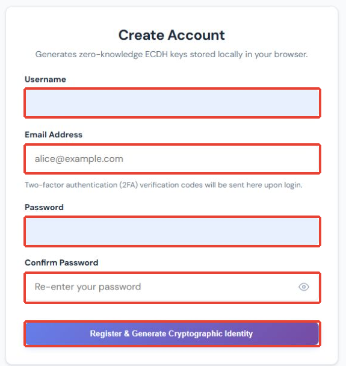 | 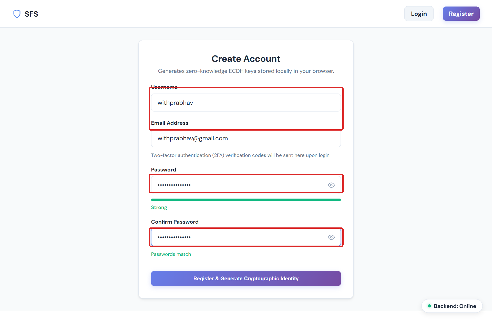 |

---

### 3. Two-Factor Authentication (2FA) & 30s Resend Timer

Every sign-in requires second-factor authorization. A 6-digit verification code is dispatched via Brevo transactional email from `securefilesharing303.project@gmail.com`. If email delivery is delayed, users can trigger the **Resend Code** action after a 30-second cooldown timer.

| 2FA Challenge & 30s Resend Timer | Verification Email in Inbox |
| :---: | :---: |
| 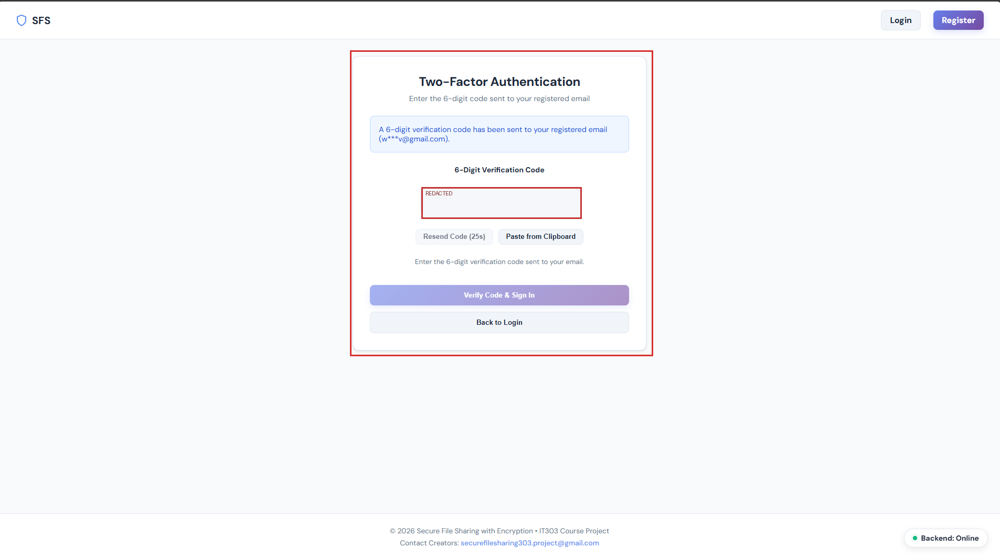 | 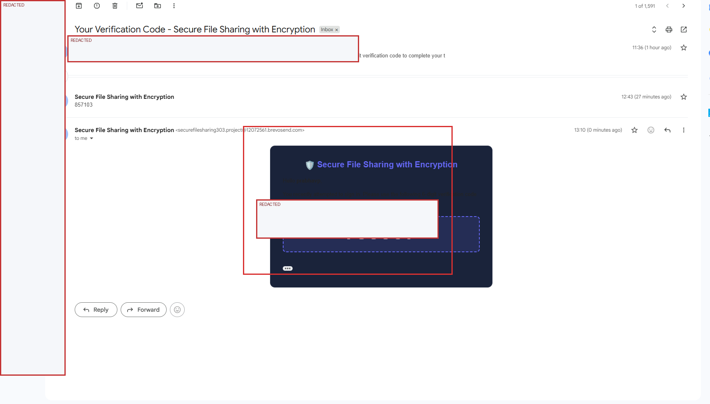 |

---

### 4. Password Recovery Workflow

Users who lose access to their credentials can initiate self-service password recovery. A time-limited, signed JWT reset link (valid for 30 minutes) is delivered directly to their registered email address.

| Forgot Password Request | Password Reset Email | Reset Password Form |
| :---: | :---: | :---: |
| 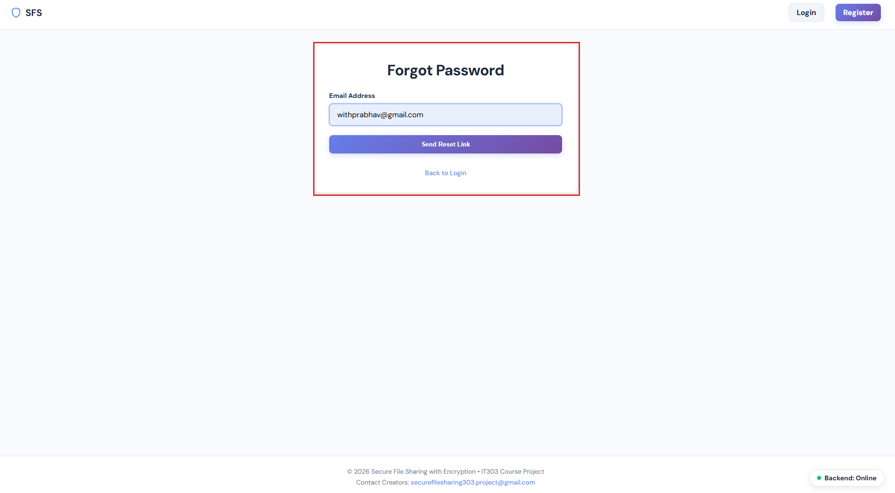 | 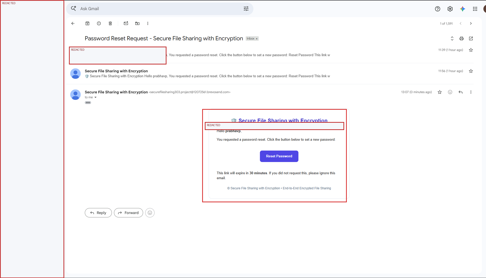 | 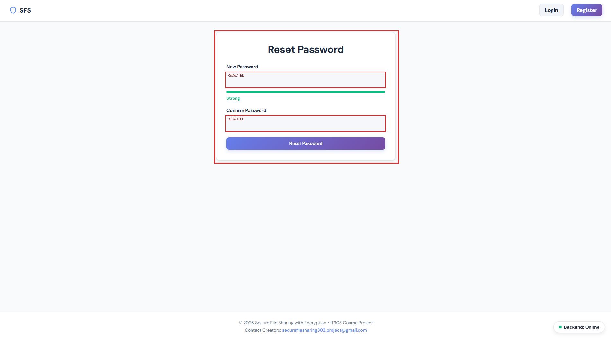 |

---

### 5. End-to-End Encrypted File Upload

Users specify the recipient's handle. The frontend queries the public directory (`GET /auth/users/public-key`), creates a random 256-bit AES-GCM session key, encrypts the file locally, and wraps the key envelope using ECDH.

| File Selection & Queue | Upload Confirmation |
| :---: | :---: |
| 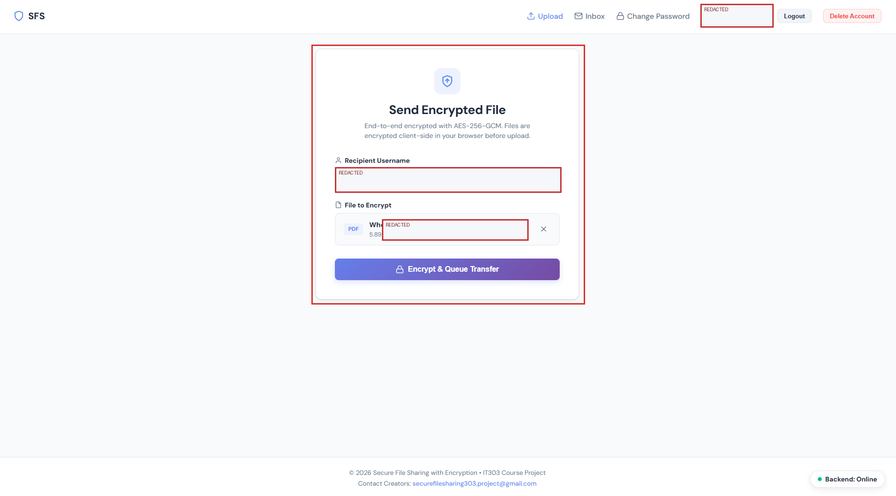 | 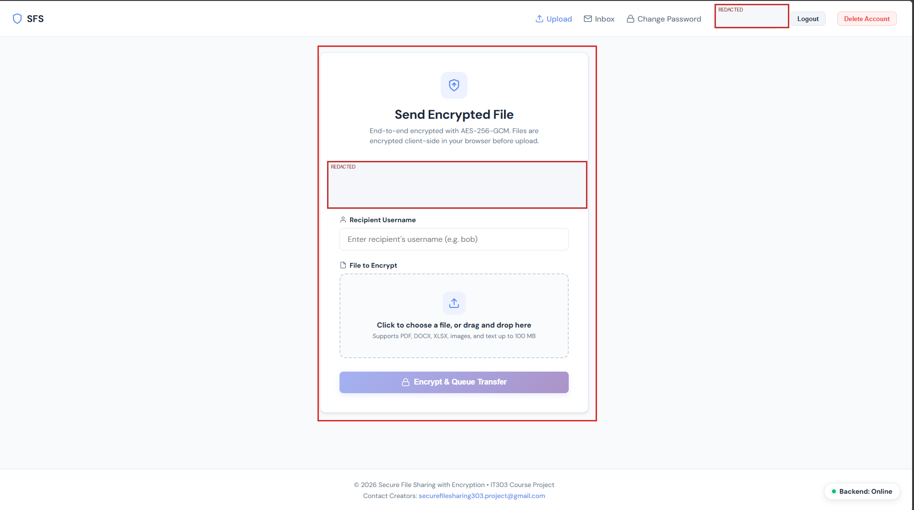 |

---

### 6. Receiver Inbox: Dual Download & Manual Purge Control

The receiver inbox provides complete transparency and download flexibility:
- **Decrypt & Download:** Extracts the private key from IndexedDB, derives the AES key via HKDF, decrypts the payload in browser memory, and saves the original file.
- **Download Encrypted (.bin):** Downloads raw ciphertext for archival or independent cryptographic verification.
- **Dual Retention & Remove Button:** Files are not discarded automatically on the first download. Receivers can download both versions and click **Remove** to wipe the ciphertext from server storage when finished.

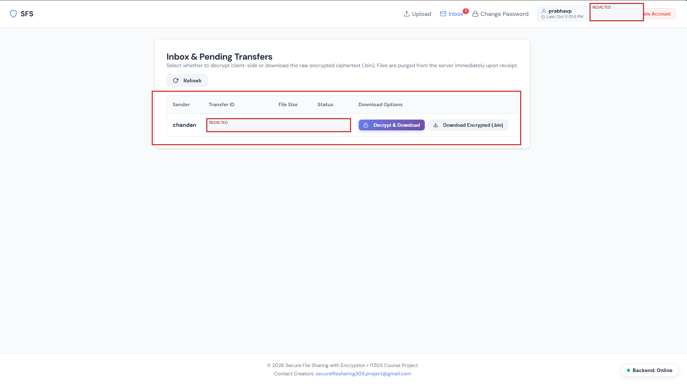

---

### 7. In-App Password Modification

Authenticated users can update their account password directly from their profile menu without affecting their cryptographic key pairs stored in IndexedDB.

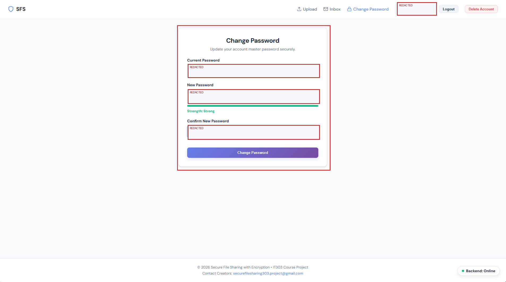

---

### 8. Account Deletion & Key Purge

Users can permanently delete their account. This purges private keys from the local browser IndexedDB and erases pending file blobs from server storage while maintaining audit compliance logs.

| Deletion Confirmation Warning | Completion Notice |
| :---: | :---: |
| 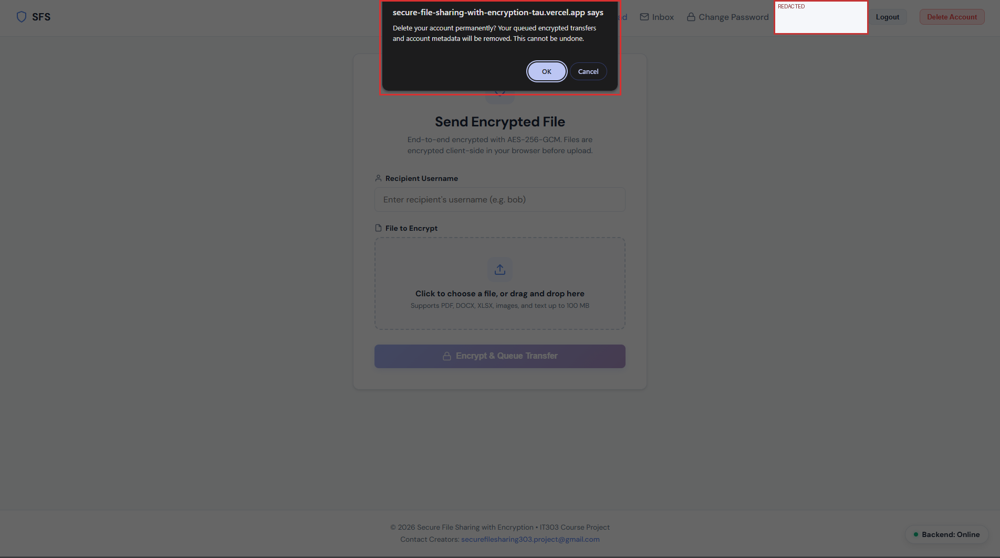 | 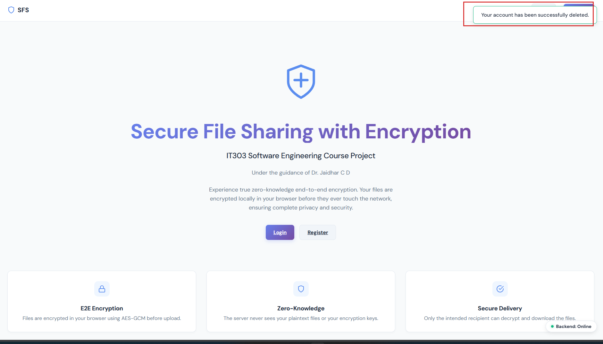 |

---

### 9. System Administrator Audit Panel & Signed PDF Report

Administrators log in to monitor system activity, review registered users with **accurate last login timestamps**, inspect transfer audit logs, and export tamper-evident forensic PDF reports with standardized units (B, KB, MB, GB).

| Registered Users & Last Login | Forensic Activity Logs | Exported Forensic PDF Report |
| :---: | :---: | :---: |
| 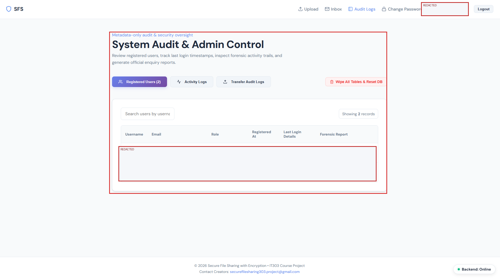 | 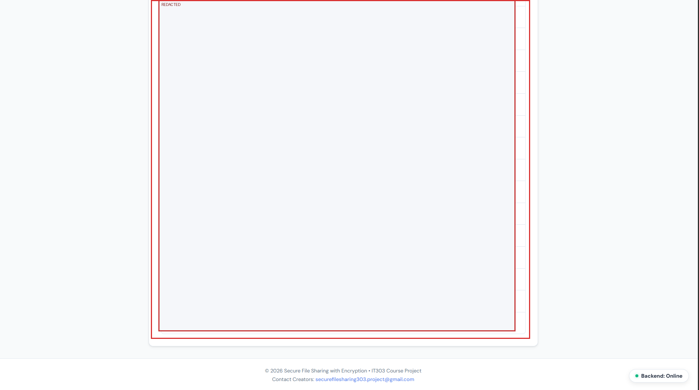 | 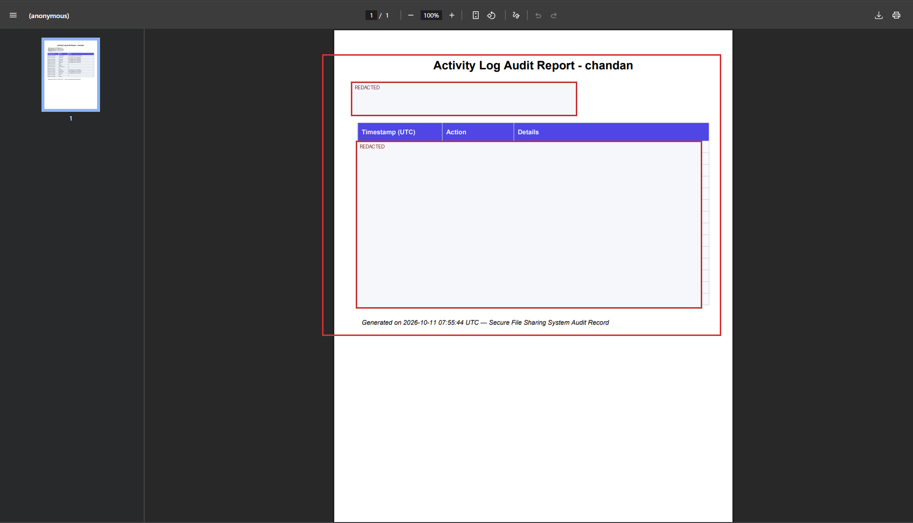 |

---

## Cryptographic Pipeline

```
Sender Browser                              Server / Storage                         Receiver Browser
==============                              ================                         ================
1. Fetch Recipient Public Key ─────────────> [ Public Directory ]
2. Generate Ephemeral ECDH Key Pair
3. Compute Shared Secret via ECDH
4. Derive AES Key via HKDF-SHA256
5. Encrypt File with AES-256-GCM
   (Generates Nonce + Ciphertext + Tag)
6. Upload Envelope + Ciphertext ───────────> [ Store Blob & Meta ]
                                                                    7. Fetch Transfer
                                             <───────────────────────
                                                                    8. Load Private Key (IndexedDB)
                                                                    9. Compute Shared Secret via ECDH
                                                                    10. Derive AES Key via HKDF
                                                                    11. Decrypt & Verify Auth Tag
                                                                    12. Save Plaintext to Disk
                                             [ Delete Blob / Purge ] <─── 13. Explicit Purge / Ack
```

---

## Tech Stack

### Frontend
- **Framework:** React 19, TypeScript, Vite
- **Styling:** Custom Impeccable CSS Light Theme with CSS custom variables
- **Cryptography:** Native browser WebCrypto API (`window.crypto.subtle`)
- **Key Storage:** Browser `IndexedDB` for non-extractable private keys

### Backend
- **Framework:** FastAPI (Python 3.11+)
- **ORM & Database:** SQLAlchemy 2.0 with PostgreSQL (Production on Render) and SQLite (Local development)
- **Email Service:** Brevo (Sendinblue) Transactional HTTP API & SMTP fallback
- **Authentication:** Bcrypt password hashing + signed PyJWT session tokens
- **PDF Generation:** ReportLab 4.x for administrative audit logs

---

## Repository Structure

```
├── backend/
│   ├── app/
│   │   ├── routers/         # REST API endpoints (auth, transfers, admin)
│   │   ├── services/        # Business logic (transfers, audit, email, storage)
│   │   ├── models/          # SQLAlchemy database models
│   │   ├── schemas/         # Pydantic validation schemas
│   │   ├── utils/           # Security & token helpers
│   │   ├── config.py        # Centralized application settings
│   │   ├── db.py            # Database session management & schema migrations
│   │   └── main.py          # FastAPI application entry point
│   ├── requirements.txt     # Python dependencies
│   └── render.yaml          # Render deployment blueprint
├── frontend/
│   ├── src/
│   │   ├── api/client.ts    # Centralized HTTP API client
│   │   ├── pages/           # Landing, Login, Register, Upload, Inbox, Admin, Password Reset
│   │   ├── App.tsx          # Router configuration and global navigation
│   │   └── index.css        # Impeccable light theme design system
│   └── package.json
├── crypto/                  # Shared TypeScript cryptographic utilities
├── docs/
│   ├── manual_images/       # 24 extracted high-resolution user manual screenshots
│   ├── openapi.yaml         # Complete REST API specification
│   └── Secure_File_Sharing_User_Manual.pdf  # Publication-grade user manual PDF
├── user_manual/
│   ├── annotated/           # Red-rectangle annotated screenshots
│   └── Secure_File_Sharing_User_Manual.pdf  # 13-page official NITK user manual
└── README.md
```

---

## Local Setup & Installation

### Prerequisites
- Python 3.10+
- Node.js 18+ and npm
- Git

### 1. Backend Setup

```bash
cd backend

# Create and activate virtual environment
python -m venv .venv
# On Windows:
.venv\Scripts\activate
# On Linux / macOS:
source .venv/bin/activate

# Install dependencies
pip install -r requirements.txt

# Configure environment variables
cp .env.example .env

# Run FastAPI development server
uvicorn app.main:app --reload --port 8000
```
- API Docs: [http://localhost:8000/docs](http://localhost:8000/docs)
- Health Check: [http://localhost:8000/health](http://localhost:8000/health)

### 2. Frontend Setup

```bash
cd frontend

# Install dependencies
npm install

# Start Vite development server
npm run dev
```
- Web Application: [http://localhost:5173](http://localhost:5173)

---

## Configuration & Environment Variables

Create a `.env` file inside `backend/` with the following variables:

```env
# Application
PROJECT_NAME="Secure File Sharing with Encryption"
DEBUG=true
FRONTEND_URL="https://secure-file-sharing-with-encryption-tau.vercel.app"

# Database (SQLite by default, PostgreSQL in production)
DATABASE_URL="sqlite:///./secure_file_sharing.db"

# Security & Tokens
JWT_SECRET_KEY="your-super-secret-jwt-key"
PASSWORD_RESET_EXPIRE_MINUTES=30
MFA_CODE_EXPIRE_SECONDS=300

# Transactional Email (Brevo)
BREVO_API_KEY="xkeysib-your-brevo-api-key"
EMAIL_FROM="securefilesharing303.project@gmail.com"
EMAIL_FROM_NAME="Secure File Sharing with Encryption"
```

---

## Support & Contact

For academic inquiries, bug reports, or security disclosures, please contact the project team:
- 📧 **Project Email:** `securefilesharing303.project@gmail.com`
- 🏫 **Department:** Department of Information Technology, NITK Surathkal
